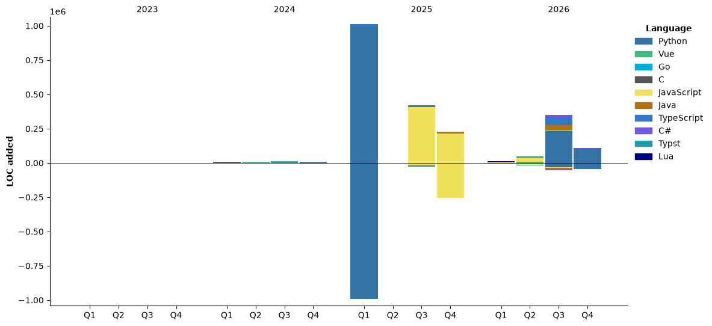

## Hi there 👋

**I'm `Kingcq`, an Intelligent Software Engineering student from `Nanjing University`.**

**I'm currently working on the following projects:**

- [x] [GoneBot —— A simple yet powerful golang chatbot framework](https://github.com/gonebot-dev/gonebot)
- [x] [GoneBuilder-TUI —— User-friendly gonebot builder in your terminal](https://github.com/gonebot-dev/gonebuilder-tui)
- [x] [GoneRepo —— Plugin & Adapters Repository for GoneBot](https://github.com/gonebot-dev/gonerepo)

**If you are interested in `GoneBot`, read our documentation [here](https://gonebot-dev.github.io/), we are looking forward to your contributions!**

**Also, these projects I worked on previously may be of interest to you:**

- [x] [Console-Runner —— A Simple Parkour Game in Terminal written in C](https://github.com/Kingcxp/Console-Runners)
- [x] [FastAPI_Template —— A template for FastAPI to quickly start your project!](https://github.com/Kingcxp/FastAPI_Template)

**Here are my GitHub stats: 👇**
<!--START_SECTION:waka-->


**🐱 My GitHub Data** 

> 📦 496.5 kB Used in GitHub's Storage 
 > 
> 🏆 883 Contributions in the Year 2026
 > 
> 🚫 Not Opted to Hire
 > 
> 📜 23 Public Repositories 
 > 
> 🔑 5 Private Repositories 
 > 
**I'm a Night 🦉** 

```text
🌞 Morning                248 commits         ███░░░░░░░░░░░░░░░░░░░░░░   10.24 % 
🌆 Daytime                875 commits         █████████░░░░░░░░░░░░░░░░   36.13 % 
🌃 Evening                674 commits         ███████░░░░░░░░░░░░░░░░░░   27.83 % 
🌙 Night                  625 commits         ██████░░░░░░░░░░░░░░░░░░░   25.81 % 
```
📅 **I'm Most Productive on Sunday** 

```text
Monday                   377 commits         ████░░░░░░░░░░░░░░░░░░░░░   15.57 % 
Tuesday                  242 commits         ██░░░░░░░░░░░░░░░░░░░░░░░   09.99 % 
Wednesday                353 commits         ████░░░░░░░░░░░░░░░░░░░░░   14.57 % 
Thursday                 313 commits         ███░░░░░░░░░░░░░░░░░░░░░░   12.92 % 
Friday                   270 commits         ███░░░░░░░░░░░░░░░░░░░░░░   11.15 % 
Saturday                 429 commits         ████░░░░░░░░░░░░░░░░░░░░░   17.71 % 
Sunday                   438 commits         █████░░░░░░░░░░░░░░░░░░░░   18.08 % 
```


📊 **This Week I Spent My Time On** 

```text
🕑︎ Time Zone: Asia/Shanghai

💬 Programming Languages: 
Python                   17 hrs 14 mins      ███████████░░░░░░░░░░░░░░   45.29 % 
Markdown                 11 hrs 13 mins      ███████░░░░░░░░░░░░░░░░░░   29.47 % 
Other                    4 hrs 5 mins        ███░░░░░░░░░░░░░░░░░░░░░░   10.76 % 
YAML                     2 hrs 2 mins        █░░░░░░░░░░░░░░░░░░░░░░░░   05.36 % 
TypeScript               56 mins             █░░░░░░░░░░░░░░░░░░░░░░░░   02.48 % 

🔥 Editors: 
VS Code                  22 hrs 13 mins      ███████████████░░░░░░░░░░   58.39 % 
Codex Vscode             11 hrs 36 mins      ████████░░░░░░░░░░░░░░░░░   30.50 % 
Claude Code              4 hrs 13 mins       ███░░░░░░░░░░░░░░░░░░░░░░   11.11 % 

🐱‍💻 Projects: 
MatQuery                 18 hrs 45 mins      ████████████░░░░░░░░░░░░░   49.26 % 
mailflow                 9 hrs 39 mins       ██████░░░░░░░░░░░░░░░░░░░   25.37 % 
nixos                    2 hrs 57 mins       ██░░░░░░░░░░░░░░░░░░░░░░░   07.76 % 
nixos_configuration      2 hrs 7 mins        █░░░░░░░░░░░░░░░░░░░░░░░░   05.57 % 
wo                       1 hr 34 mins        █░░░░░░░░░░░░░░░░░░░░░░░░   04.13 % 

💻 Operating System: 
Windows                  38 hrs 4 mins       █████████████████████████   100.00 % 
```

🤖 **AI Coding This Week** 

```text
⏱ AI Coding Time: 36 hrs 24 mins (95.63%)

✍️ 33,994 lines written by AI, 429 lines written by hand (98.75% AI-written)

🔤 30,199,338 Input Tokens, 3,712,285 Output Tokens

💵 $474.05 Estimated AI Cost This Week

🧠 137 AI Sessions, 204 AI Prompts

GPT                      19,568 lines        ██████████████░░░░░░░░░░░   56.56 % 
Fable                    7,994 lines         ██████░░░░░░░░░░░░░░░░░░░   23.11 % 
Opus                     7,036 lines         █████░░░░░░░░░░░░░░░░░░░░   20.34 % 

🔎 AI Coding Insights:
🤖 AI-Driven — 98.75% of written lines came from AI
📚 Verbose Prompter — average 1,698 characters per prompt
🎯 One-Shot Prompter — average 1 prompts per session
🚀 High AI Trust — 1.26% of changed lines were hand-edited
```

**I Mostly Code in Python** 

```text
Python                   12 repos            ██████████░░░░░░░░░░░░░░░   38.71 % 
Java                     5 repos             ████░░░░░░░░░░░░░░░░░░░░░   16.13 % 
Typst                    2 repos             ██░░░░░░░░░░░░░░░░░░░░░░░   06.45 % 
Shell                    2 repos             ██░░░░░░░░░░░░░░░░░░░░░░░   06.45 % 
C#                       1 repo              █░░░░░░░░░░░░░░░░░░░░░░░░   03.23 % 
```


**Timeline**




 Last Updated on 17/11/2026 02:44:45 UTC
<!--END_SECTION:waka-->

[](https://github.com/anuraghazra/github-readme-stats)    

[](https://git.io/streak-stats)

[](https://github.com/ryo-ma/github-profile-trophy)

[](https://github.com/ashutosh00710/github-readme-activity-graph)